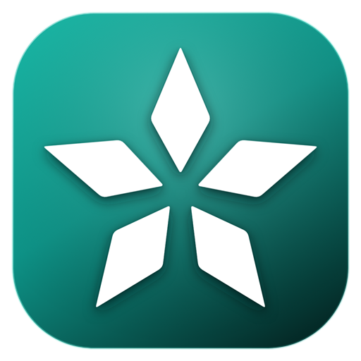
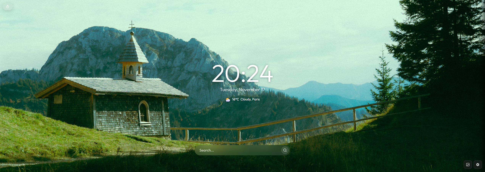
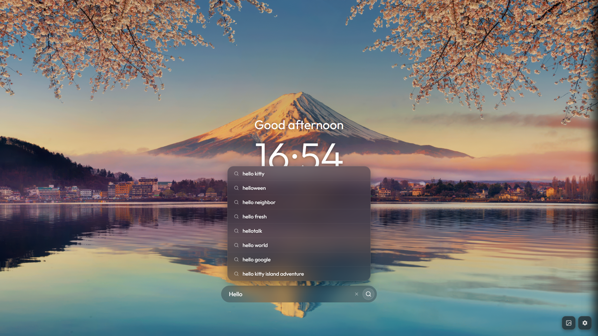
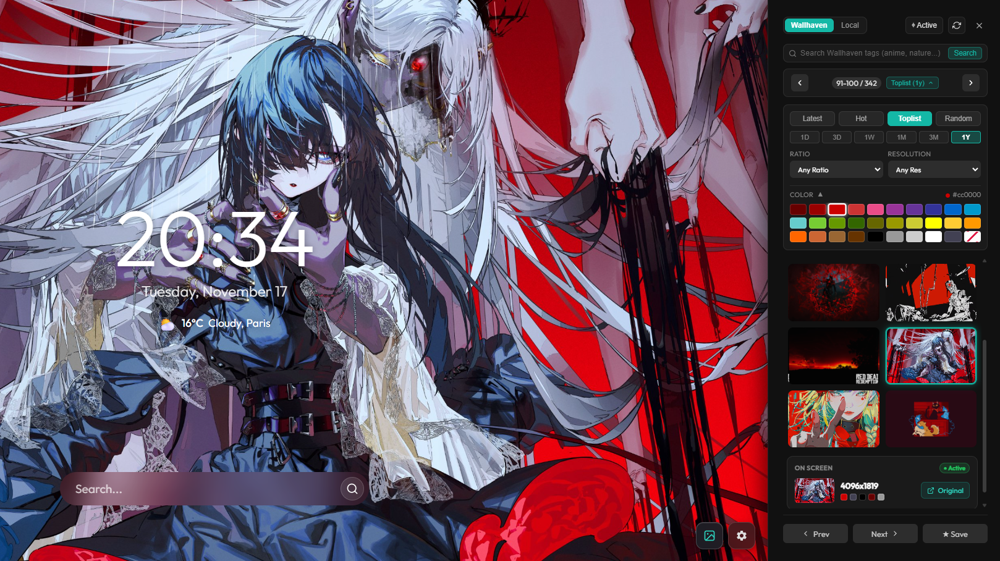
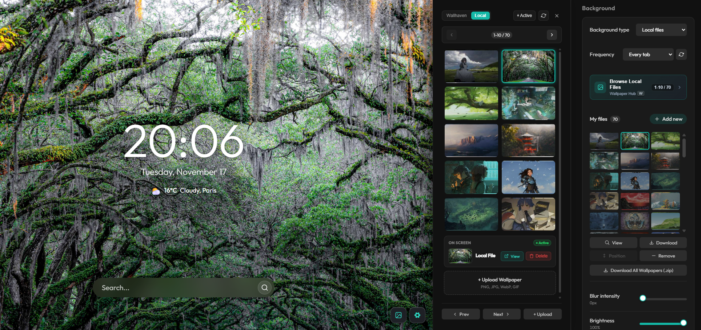
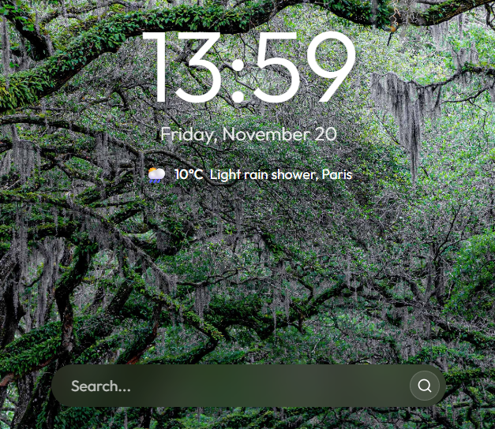
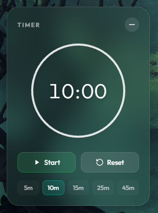
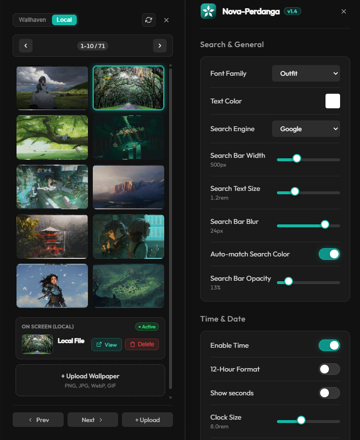

<div align="center">
  
  <h1>Nova-Perdanga</h1>
  <p><i>Your browser's window to Wallhaven!</i></p>
</div>

<div align="center">
  <a href="assets/screenshots/nova-perdanga-showcase.png">
    
  </a>
</div>

<table width="100%">
  <tr>
    <td width="50%" align="center" valign="top">
      <a href="assets/screenshots/nova-perdanga-search.png"></a>
      <p align="center"><sub><b>Smart Search & Real-Time Suggestions</b></sub></p>
    </td>
    <td width="50%" align="center" valign="top">
      <a href="assets/screenshots/nova-perdanga-wallhaven.png"></a>
      <p align="center"><sub><b>Wallhaven Hub & Color Palette Filter</b></sub></p>
    </td>
  </tr>
  <tr>
    <td width="50%" align="center" valign="top">
      <a href="assets/screenshots/nova-perdanga-dual.png"></a>
      <p align="center"><sub><b>Offline Local Library & Dual Drawer Management</b></sub></p>
    </td>
    <td width="50%" align="center" valign="top">
      <a href="assets/screenshots/nova-perdanga-weather.png"></a>
      <p align="center"><sub><b>Accurate Weather Forecast & Dynamic Greetings</b></sub></p>
    </td>
  </tr>
  <tr>
    <td width="50%" align="center" valign="top">
      <a href="assets/screenshots/nova-perdanga-timer.png"></a>
      <p align="center"><sub><b>Draggable Floating Pomodoro Timer</b></sub></p>
    </td>
    <td width="50%" align="center" valign="top">
      <a href="assets/screenshots/nova-perdanga-settings.png"></a>
      <p align="center"><sub><b>Glassmorphic Controls & 15 Curated Fonts</b></sub></p>
    </td>
  </tr>
</table>

## Overview

**Nova-Perdanga** transforms your browser's default New Tab into a personal dashboard. It combines the infinite library of **Wallhaven** with your own offline wallpaper collection, smart color adaptation, and power-user keyboard controls.

## Installation

1. Git clone this repository:
   ```bash
   git clone https://github.com/PerdangaSoftware/Nova-Perdanga.git
   ```
2. Open your Chromium-based browser.
3. Navigate to `chrome://extensions/`.
4. Toggle **Developer mode** on (top right corner).
5. Click **Load unpacked** and select the extension folder.
6. Open a new tab and enjoy!

## Features

### Wallpaper Engine
- **Wallhaven Integration**: Automatically stream wallpapers by tags, collections, or color palette. Press **S** or click **★ Save** to store in local storage.
- **Wallhaven Hub Drawer**: Browse wallpapers with live pagination, quick filters (**Latest**, **Hot**, **Toplist**, **Random**), and instant thumbnail preview.
- **Local Storage Gallery**: Upload your personal wallpapers directly into browser-native IndexedDB.
- **One-Click Batch Download (.zip)**: Export your entire wallpaper collection into a neat `.zip` archive with a single click.
- **Custom Framing**: Adjust vertical alignment per wallpaper for optimal positioning.

### Search
- **Search Autocomplete**: Real-time suggestions.
- **Dynamic Color Matching**: Automatically extracts the dominant background color to tint the search bar.
- **Search Bangs**: Jump directly to popular services by prefixing queries:
  - `!y <query>` → YouTube
  - `!wiki <query>` → Wikipedia (supports multilingual & Cyrillic queries)
  - `!r <query>` → Reddit
  - `!gh <query>` → GitHub

### Keyboard Shortcuts

| Key | Action |
| :--- | :--- |
| `/` or `Space` | Focus search |
| `G` | Toggle Wallhaven drawer |
| `O` or `,` | Toggle settings |
| `N` or `→` | Next wallpaper |
| `P` or `←` | Previous wallpaper |
| `M` | Switch mode (Wallhaven ⟷ Local) |
| `S` | Save to local |
| `H` / `Z`  | Zen Mode (hide UI) |
| `Esc` | Close / Exit |

### Timer Widget
- Draggable, collapsible floating timer with circular progress and chime alarms.

### Weather & Clock
- Accurate weather (temperature, weather status, weather icons).
- Fully customizable clock (12h/24h, optional seconds), date format, and dynamic greetings.

### Customization
- **15 Curated Fonts**: Outfit *(default)*, Inter, Plus Jakarta Sans, Montserrat, Manrope, Onest, Unbounded, Space Grotesk, Comfortaa, Roboto Flex, Playfair Display, Cormorant Garamond, Cinzel, JetBrains Mono, and Roboto Mono.
- **Visual Controls**: Background blur, search bar blur, opacity, brightness, transition speed, and typography sizing.
- **Live Value Badges**: Real-time numerical feedback for all sliders.

### Safe Configuration Backup & Restore
- **Binary ZIP Export**: Back up your settings, timers, and high-resolution wallpapers into `novaperdanga_backup.zip`.
- **Universal Importer**: Effortlessly restore settings from both new `.zip` backups and legacy `.json` files.

## Privacy

Nova-Perdanga respects your privacy:
- **No tracking**: All data, settings, and images stay strictly inside your browser.
